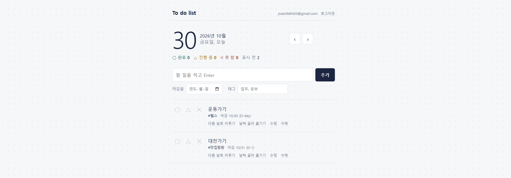
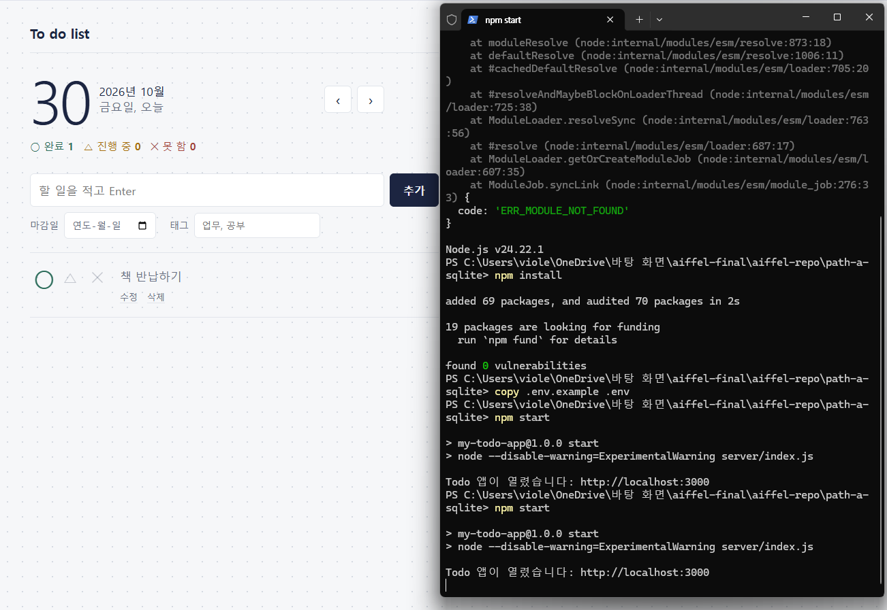
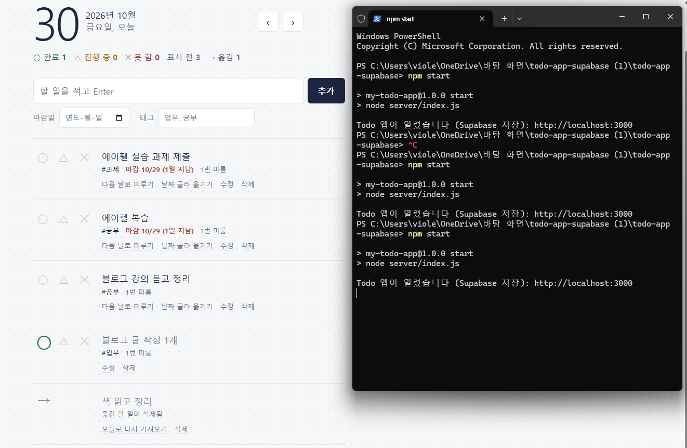
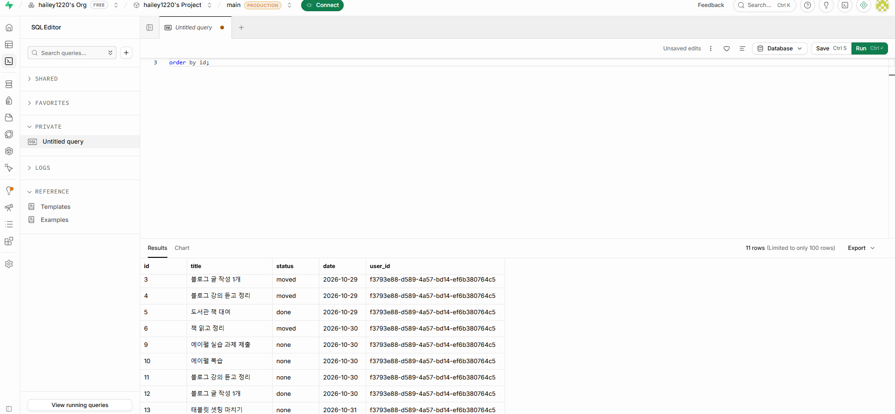
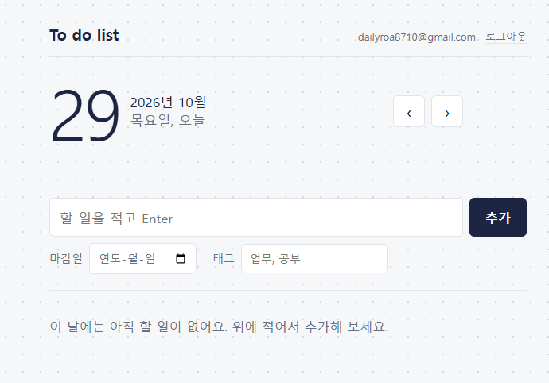
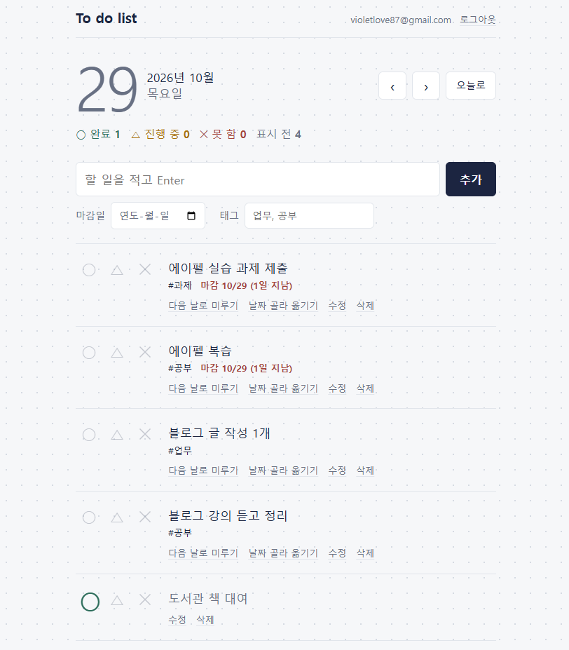
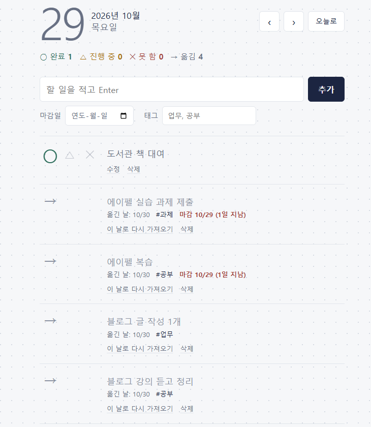
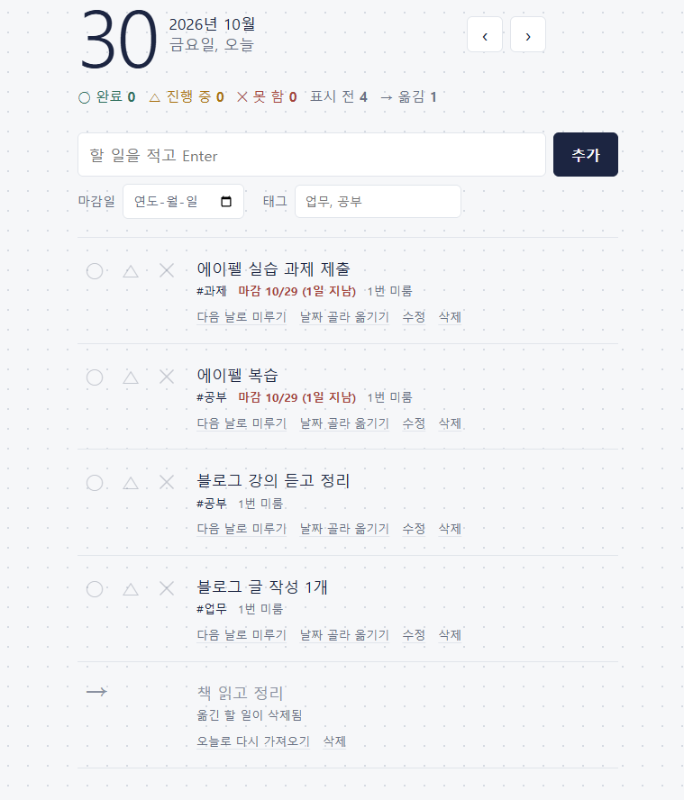

# AIFFEL Campus Agent Code Review Templete
- 개발자 : hailey1220
- 리뷰어 : 서진수

# ART(Agent Review Template)
[x] **1. 원하는 기능이 의도한 대로 동작하나요?**
- 요청(프롬프트)한 기능이 정상적으로 구현되었는지?
  - PRD의 기본 기능(추가·조회·수정·삭제)과 직접 넣은 기능(○△✕ 진행 상태, 미루기 기록 →, 미룬 횟수, D-day, 태그)이 길 A(SQLite)와 길 B(Supabase)에 모두 구현되어 있습니다.
  - 길 B에서는 회원가입·로그인·로그아웃을 Supabase Auth로 붙이고, 할 일마다 `user_id`(주인)를 기록합니다.
  - PRD의 "완성 확인" 표에 체크한 항목마다 README에 근거 스크린샷이 있어서, 리뷰어가 동작 여부를 바로 확인할 수 있었습니다.
  - Render 배포 주소(https://aiffel-project2.onrender.com)와 배포 설정값도 README와 PRD에 정리되어 있습니다.
- 실제 실행 화면/결과물을 캡처하여 근거로 첨부
  - **[리뷰어 직접 확인] 배포 사이트에서 회원가입·로그인 후 할 일 추가**
    - 배포 주소에 새 계정으로 가입해 로그인한 뒤, 마감일과 태그를 넣어 할 일 2개를 추가했습니다.
    - 오늘 날짜(10/30, 금요일, 오늘) 표시, 태그(`#헬스`, `#맛집탐방`), D-day 표시(`D-day`, `D-1`), 상단 집계(표시 전 2)가 의도대로 동작하는 것을 확인했습니다.
    - 오른쪽 위에 로그인한 계정과 로그아웃 버튼이 표시되고, 다른 사람의 할 일은 보이지 않았습니다.

    

  - 아래는 개발자가 README에 첨부한 화면입니다.
  - 길 A 재시작 후에도 데이터 유지: 
  - 길 B 재시작 후에도 데이터 유지: 
  - Supabase `todos` 표에 `user_id`와 함께 저장됨: 
  - 다른 계정으로 로그인하면 할 일이 보이지 않음(RLS): 
  - 미루기 전 → 미룬 뒤 → 다음 날 "1번 미룸" 표시:
    
    
    

[x] **2. 보안 검토를 수행했나요?**
- API 키, 비밀번호 등 민감 정보가 코드에 하드코딩되지 않았는지
  - Supabase URL과 키는 `.env`에서만 읽고, `.env`는 `.gitignore`에 들어 있습니다. `.env.example`에는 `xxxx` 형태의 자리표시 값만 있습니다.
  - 화면 코드(`public/`)에는 키도, Supabase 호출 코드도 없습니다. 화면은 백엔드 API(`/api/...`)에만 요청합니다.
  - 관리자 키(`sb_secret_` 또는 `service_role`)를 실수로 넣으면 서버가 시작을 거부하도록 막아 두었습니다(`server/supabase.js`). 관리자 키를 쓰면 RLS가 무시되는 위험을 코드 차원에서 차단한 점이 좋습니다.
  - 로그인 토큰은 화면의 자바스크립트가 읽을 수 없는 httpOnly 쿠키에 보관합니다. 배포 환경에서는 Secure 쿠키도 켜집니다.
- 사용자 입력값 검증 등 기본 보안 사항 확인
  - 서버에서 날짜 형식과 실제 존재하는 날짜인지, 할 일 번호, 제목 길이(200자), 태그 개수와 길이, 이메일 형식, 비밀번호 길이(8~72자)를 검사합니다.
  - DB에도 `check` 제약(제목 길이, 상태 값, 미룬 횟수 ≥ 0)이 있어서 이중으로 막혀 있습니다.
  - 할 일 내용은 `textContent`로 화면에 넣기 때문에, 내용에 HTML이나 스크립트를 넣어도 실행되지 않습니다(XSS 방지).
  - 모든 표에 RLS를 켜고 "본인 것만 조회·추가·수정·삭제" 정책을 두었습니다. 태그 연결 표(`todo_tags`)도 할 일과 태그가 둘 다 내 것일 때만 연결되도록 막았습니다.
  - `npm run check-rls` 스크립트로 "로그인 안 한 사용자"와 "다른 사용자"가 남의 할 일을 조회·수정·삭제할 수 없는지 직접 확인했고, 그 결과를 PRD 기록에 남겼습니다.
- 외부 데이터/의존성 사용 시 출처와 위험 검토했는지
  - 의존성은 `express`, `dotenv`, `@supabase/supabase-js`, `@supabase/ssr`로 꼭 필요한 것만 사용했습니다. 로그인은 직접 만들지 않고 Supabase 공식 라이브러리를 사용한다는 원칙을 PRD와 README에 명시했습니다.
  - 길 A는 별도 라이브러리 없이 Node.js 내장 SQLite를 사용해 외부 의존성을 줄였습니다.

[ ] **3. 에러가 난 부분을 디버깅하여 "문제를 해결한 기록"을 남겼나요?**
- 에이전트가 만든 코드의 오류를 어떻게 발견하고 수정했는지
  - 코드 곳곳에서 문제를 겪고 해결한 흔적이 보입니다.
    - 예전 `todo.db`에 `none` 상태가 없던 문제를 자동으로 고치는 마이그레이션 코드(`path-a-sqlite/server/db.js`)
    - 로그인 없는 버전의 스키마를 이미 실행한 경우의 안내(`schema.sql` 상단)
    - 포트 사용 중, 스키마 미실행, Supabase 연결 실패 같은 상황별 에러 안내
    - Supabase가 새 표에 권한을 자동으로 주지 않게 바뀐 점에 대응한 GRANT 설정
  - 다만 **"어떤 에러가 났고 → 원인이 무엇이었고 → 어떻게 고쳤는지"를 정리한 기록은 저장소에서 찾지 못했습니다.** PRD의 "기록"에는 확인 결과(성공)만 있습니다.
- 새로운 시도 및 추가 실험이 기록되어 있는지
  - RLS 확인 스크립트와 그 결과 기록은 좋은 실험 기록입니다.
  - 위에서 말한 마이그레이션이나 GRANT 대응 같은 경험을 PRD의 "기록"이나 별도 `TROUBLESHOOTING.md`에 2~3줄씩 남기면 이 항목도 충분히 채워질 것 같습니다.

# 참고 링크 및 코드 개선

## 1.리뷰 시 참고한 링크가 있다면 링크와 간략한 설명을 첨부합니다.
- [Supabase - Row Level Security](https://supabase.com/docs/guides/database/postgres/row-level-security) : RLS 정책 작성법과 `(select auth.uid())` 형태를 권장하는 이유를 확인했습니다.
- [Supabase - Server-Side Auth (@supabase/ssr)](https://supabase.com/docs/guides/auth/server-side) : 서버에서 쿠키로 로그인 상태를 관리하는 공식 방식과 코드가 맞는지 확인했습니다.
- [Supabase - API Keys](https://supabase.com/docs/guides/api/api-keys) : publishable 키와 secret 키의 차이, 그리고 secret 키를 쓰면 RLS가 적용되지 않는다는 점을 확인했습니다.
- [Supabase - Auth Rate Limits](https://supabase.com/docs/guides/auth/rate-limits) : 회원가입·로그인 요청 횟수 제한이 어떻게 걸리는지 확인했습니다(개선 제안 4번 근거).
- [MDN - HTTP 쿠키](https://developer.mozilla.org/ko/docs/Web/HTTP/Cookies) : httpOnly, Secure, SameSite 쿠키 옵션의 의미를 확인했습니다.

## 2.리뷰를 통해 개선을 제안할 부분이 있다면 내용과 간략한 설명을 첨부합니다.

**1) PRD 마지막 줄이 깨져 있어요 (바로 고칠 수 있음)**
```
- 배포 URL: (도전·성공 시 작성)- 배포 URL: https://aiffel-project2.onrender.com ...
```
자리표시 문구 뒤에 실제 주소가 이어 붙어 있습니다. 앞부분 `(도전·성공 시 작성)- 배포 URL:`을 지우면 됩니다.

**2) 완료한 할 일이 "다시 가져오기"로 옮겨질 수 있어요 (규칙이 서로 어긋남)**
- 서버에는 "완료한 할 일은 옮길 수 없다"는 규칙이 있습니다(`server/index.js`의 미루기 API).
- 그런데 10/29의 할 일을 10/30으로 미루고, 10/30에서 완료(○)한 뒤, 10/29의 → 기록에서 "다시 가져오기"를 누르면 이 규칙을 거치지 않습니다. 할 일은 완료 상태 그대로 10/29로 돌아가고, → 기록은 사라집니다.
- 원인은 `bring_back_todo` DB 함수가 마지막 할 일의 상태를 확인하지 않고 `move_todo`를 부르기 때문입니다.
- 의도한 동작이 무엇인지 정한 뒤, 완료된 할 일이면 막거나 "다시 가져오기" 버튼을 숨기는 것을 제안합니다.

**3) 버튼을 빠르게 두 번 누르면 요청이 두 번 갈 수 있어요**
- "추가"에서 Enter를 연타하면 같은 할 일이 두 개 생길 수 있습니다.
- "다음 날로 미루기"를 두 번 누르면 두 번째 요청에서 "이미 옮긴 할 일입니다" 에러가 표시됩니다.
- 로그인 버튼에 이미 적용한 방식(요청 중에는 `disabled = true`)을 할 일 버튼에도 똑같이 적용하면 해결됩니다.

**4) 공개 배포 시 회원가입 남용 대비**
- 회원가입·로그인 요청은 모두 Render 서버 하나를 거쳐 Supabase로 갑니다. Supabase의 요청 횟수 제한이 IP 기준으로 걸리면, 누군가 요청을 반복할 때 **모든 사용자가 함께 "요청이 너무 많습니다"를 보게 될 수 있습니다.**
- 과제 범위에서는 괜찮지만, 실서비스로 키운다면 Express 서버에 요청 횟수 제한(예: `express-rate-limit`)을 두는 것을 제안합니다.

**5) 로그인 없는 접근 권한은 시험 후 닫기 (사소함)**
- `schema.sql` 끝의 `grant select, insert on public.todos to anon`은 RLS가 막는 걸 확인하려고 일부러 열어 둔 것이고, 그 이유도 주석에 적혀 있습니다.
- 실제로는 RLS가 막아 주지만, 확인이 끝났다면 닫아 두는 편이 더 깔끔합니다.

**6) 그 밖의 사소한 것들**
- 길 A와 길 B의 화면 코드가 대부분 같아서, 한쪽만 고치고 다른 쪽을 잊기 쉽습니다. 길 A README에 "완료된 단계(더 이상 수정하지 않음)"라고 한 줄 적어 두면 좋겠습니다.
- 루트 README와 길 B README의 실행 방법이 윈도우 명령어(`copy`, `notepad`)만 있습니다. 길 A README처럼 맥 명령어(`cp`)도 함께 적어 두면 다른 팀원이 따라 하기 편합니다.
- 로그인 실패 시 자주 나오는 에러는 한국어로 바꿔 두었지만, 나머지는 Supabase의 영어 원문이 그대로 섞여 나옵니다.
- 동작마다 "할 일이 있는지 확인 → 실제 작업 → 결과 다시 조회"로 DB를 2~3번 오갑니다. 이 규모에서는 문제없지만, Render 무료 서버에서는 조금 느리게 느껴질 수 있습니다.

# 총평
기획 의도(**"미룬 기록을 남겨 지연을 눈에 보이게"**)가 기능, 화면, DB 구조(`moved_from_id`, `postpone_count`)까지 일관되게 이어진 점이 가장 인상적이었습니다. "아직 표시 안 함"과 "못 했다고 표시함"을 구분하고, "다시 가져오기"로 미룬 횟수까지 원래대로 되돌리는 등 사용자 입장에서 세심하게 설계했습니다.

보안 면에서도 "로그인은 직접 만들지 않는다", "관리자 키를 쓰지 않아 실수해도 남의 데이터가 보이지 않게 한다"는 원칙을 문서로 세우고 코드로 지켰습니다. 특히 RLS를 "켰다"에서 끝내지 않고, 확인 스크립트와 스크린샷으로 "증명"한 점은 다른 팀원들도 참고할 만합니다.

완료된 할 일의 "다시 가져오기" 규칙과 버튼 중복 클릭 방지만 보완하고, 개발하면서 겪은 문제와 해결 과정을 짧게라도 기록으로 남기면 더 단단한 프로젝트가 될 것 같습니다. 수고 많으셨습니다!
